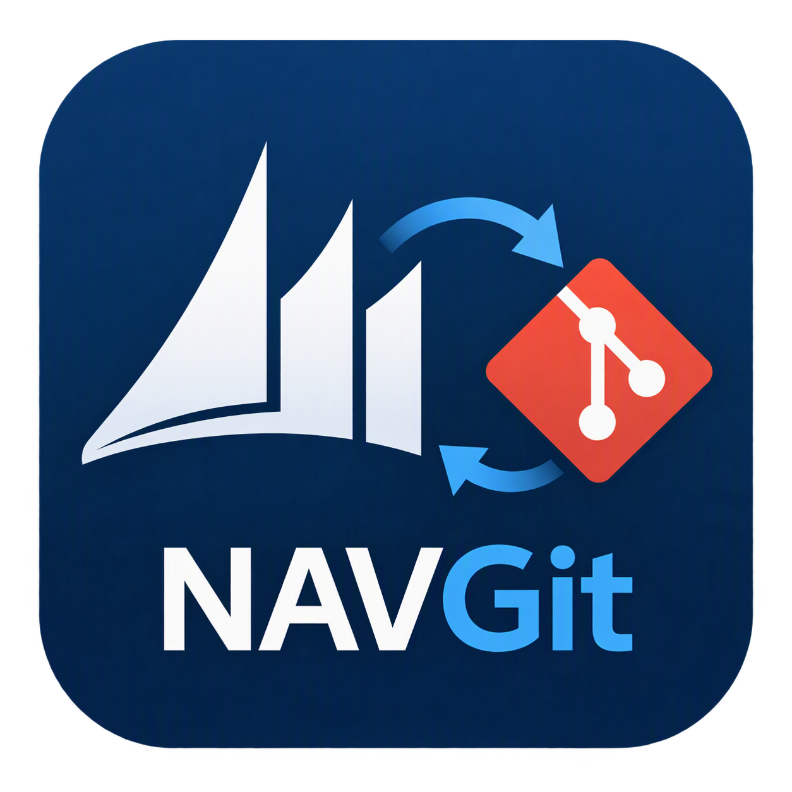

# NAVGit

{width=250px height=250px}

A slim replacement for AdvaniaGIT: a PowerShell module and a VS Code extension for working with Dynamics NAV 2016,
NAV 2017, NAV 2018 and Business Central 14 (C/AL) in Docker containers built with
[BcContainerHelper](https://github.com/microsoft/navcontainerhelper).

What NAVGit does differently from AdvaniaGIT:

- **The database backup is passed to `New-BcContainer -bakFile`** instead of as a raw `--env bakfile=` docker argument.
  BcContainerHelper then knows a backup is used and builds the image without the Cronus demo database (`-nodb`).
  Raw docker arguments that duplicate a native parameter (`--env bakfile`, `--env licensefile`, credentials,
  `--dns`, `--restart`, `--memory`, `--isolation`, ...) are rejected with a pointer to the right setting.
- **Export routes test objects to `Tests`**: objects whose Version List matches the test pattern (default: an entry
  starting with `Test`) and codeunits with `Subtype=Test` go to `Tests`, everything else to `Objects`. Objects that
  change category are moved.
- **Import reads `Objects` and `Tests`**, compares every object with the database (Version List, Modified, Date,
  Time) and imports only what changed, then compiles and force-syncs.
- **The client and C/SIDE start without elevation** and without copying the client out of the container.

Full documentation, including every `navgit.json` and user setting with its accepted values, is in [Docs](Docs/README.md).

## Requirements

- Windows with Docker (Windows containers)
- Windows PowerShell 5.1 or PowerShell 7 (both tested)
- BcContainerHelper: `Install-Module BcContainerHelper -Scope AllUsers`
- Container and object commands need an elevated (administrator) session; the client commands do not.

## Installation

PowerShell module, from the [PowerShell Gallery](https://www.powershellgallery.com/packages/NAVGit):

```powershell
Install-Module NAVGit -Scope CurrentUser    # later: Update-Module NAVGit
```

Or run *NAVGit: Install PowerShell Module* in VS Code. To use the module from a clone of this repository instead:
`Import-Module C:\Repos\NAVGit\module\NAVGit\NAVGit.psd1`.

VS Code extension (bundles the module): install **NAVGit** from the
[Visual Studio Marketplace](https://marketplace.visualstudio.com/items?itemName=TheDoubleH.navgit), or run
`code --install-extension TheDoubleH.navgit`. To build it from source:

```powershell
cd C:\Repos\NAVGit\vscode
npm install
npm run package
code --install-extension navgit-1.3.1.vsix
```

## Quick start

1. Create a `navgit.json` in the repository root:
   - from an AdvaniaGIT repository: `ConvertFrom-AdvaniaGitSetup` (or *NAVGit: Create navgit.json* in VS Code), or
   - from scratch: `New-NAVGitConfig -Nav 2018 -Cu cu30 -Country no -BakFile C:\Backups\Customer.bak`
2. Optionally create the user settings (see below), e.g. to keep using `C:\AdvaniaGIT\Backup` and `C:\AdvaniaGIT\License`.
3. Check what would be created: `Show-NAVGitContainerCommand`
4. Build the container and import the objects (elevated): `Update-NAVGitContainer`

## Commands

| VS Code (category *NAVGit*) | PowerShell | Elevated |
| --- | --- | --- |
| Build and Update Container | `Update-NAVGitContainer` | yes |
| Build Container | `New-NAVGitContainer` | yes |
| Remove Container | `Remove-NAVGitContainer` | yes |
| Import Test Toolkit | `Import-NAVGitTestToolkit` | yes |
| Import All GIT Objects to NAV | `Import-NAVGitObjects` | yes |
| Export NAV objects to GIT | `Export-NAVGitObjects` | yes |
| Compile Uncompiled Objects | `Invoke-NAVGitCompile -Scope Uncompiled` (`Compiled=No`) | yes |
| Compile Modified Objects | `Invoke-NAVGitCompile -Scope Modified` (`Modified=Yes`) | yes |
| Compile All Objects | `Invoke-NAVGitCompile -Scope All` | yes |
| Update Add-ins | `Update-NAVGitAddIns` | yes |
| Start Development Environment (FinSql) | `Start-NAVGitDevelopmentEnvironment` | no |
| Start NAV Client (default) | `Start-NAVGitClient` | no |
| Start NAV Client... | `Start-NAVGitClient -ProfileId <id>` (console: `-SelectProfile`) | no |
| Create navgit.json | `New-NAVGitConfig`, `ConvertFrom-AdvaniaGitSetup` | no |

More PowerShell commands:

- `Show-NAVGitContainerCommand`: shows the `New-BcContainer` command for the repository (dry run, no elevation).
- `New-NAVGitContainer -WhatIf`: the same, with the elevation and container checks.
- `Update-NAVGitContainerState`: re-reads a container's configuration for the client commands. Use it for containers
  that were not built by NAVGit, e.g. existing AdvaniaGIT containers.
- `Get-NAVGitProfile`: lists the profiles (role centers) of the container database.
- `Invoke-NAVGitCommand -Name <name>`: runs a command by its registry name (used by the VS Code extension).

All commands take `-Path` (default: the current folder); any folder or file inside the repository works.

Useful switches:

- `New-NAVGitContainer -Force` / `Update-NAVGitContainer -Force`: replace an existing container without asking.
- `New-NAVGitContainer -ResetCredential`: ask for the container credential again.
- `Import-NAVGitObjects -Force`: import every object file, also unchanged ones.
- `Import-NAVGitObjects -IncludeTests`: also import the `Tests` folder when `includeTestToolkit` is off. Import Test Toolkit imports it too; after either, later imports include it automatically.
- `Import-NAVGitTestToolkit -LibrariesOnly`: only the test libraries.
- `Invoke-NAVGitCompile -Filter 'Type=Codeunit;Id=50000..50099'`: compile with any C/SIDE filter.

Compiling always runs inside the container with BcContainerHelper's `Compile-ObjectsInNavContainer`, so it also
works for NavUserPassword containers. Schema changes are synchronized with `import.syncSchema` (default `Force`).

## navgit.json

Plain JSON (no comments) in the repository root. VS Code validates it with the bundled schema
(`module\NAVGit\Schema\navgit.schema.json`). Only `projectName` and `artifact` are required.

```json
{
  "projectName": "Contoso",
  "artifact": { "nav": "2016", "cu": "cu32", "country": "na" },
  "database": { "bakFile": "C:\\Backups\\Contoso.bak" },
  "licenseFile": "Customer{major}.flf",
  "auth": "NavUserPassword",
  "isolation": "hyperv",
  "includeTestToolkit": true
}
```

| Setting | Default | Description |
| --- | --- | --- |
| `projectName` | (required) | Project name; default container name and backup search name. |
| `containerName` | from `projectName` | 1-15 characters, letters, digits and `-`. Default: `projectName` with `_` → `-`, cut to 15 characters. |
| `artifact` | (required) | Exactly one form: `{ "url": "https://.../onprem/11.0.43274.0/no" }`; `{ "nav": "2018", "cu": "cu30", "country": "no" }` (Get-NavArtifactUrl; nav 2016, 2017 or 2018, cu `rtm` or `cuNN`); or `{ "version": "14.0", "country": "w1", "select": "Latest" }` (Get-BcArtifactUrl, OnPrem; select Latest, First or Closest). Versions 9 (NAV 2016) to 14 (BC14); country defaults to `w1`. |
| `navRelease` | from version | Release name in backup file names: 2016, 2017, 2018, 2019 (BC13), BC14. |
| `imageName` | `navgit` | Local image name. With a backup the cached image is built without the Cronus database. |
| `database.bakFile` | | Backup file: absolute path, path relative to the repository or the user `backupFolder`, or an http(s) URL. |
| `database.searchNames` | `[]` | Extra names to try after `projectName` when searching the `backupFolder`. |
| `database.useDemo` | `false` | Use the Cronus demo database. Without `bakFile`, a found backup or `useDemo`, building fails instead of silently using Cronus. |
| `licenseFile` | | License file: absolute, relative to the repository or the user `licenseFolder`, or a URL. `{major}` is replaced by the major version. Empty: the demo license from the artifact. |
| `auth` | `NavUserPassword` on Azure AD joined machines, `Windows` elsewhere | `Windows` or `NavUserPassword`. |
| `isolation` | `""` | `hyperv`, `process` or `""` (BcContainerHelper decides). |
| `memoryLimit` | `""` | E.g. `8G`. BcContainerHelper uses 8G for Hyper-V isolation when empty. |
| `dns` | `""` | DNS server, or `hostDNS`. |
| `updateHosts` | `true` | Add the container to the hosts file (needed by the client commands). |
| `shortcuts` | `None` | Where BcContainerHelper creates the container's shortcuts: `None`, `Desktop`, `StartMenu`, `CommonStartMenu`, `CommonDesktop`, `DesktopFolder` or `CommonDesktopFolder`. |
| `enableSymbolLoading` | `false` | Symbol loading (NAV 2018 / BC14 only). |
| `includeTestToolkit` | `false` | Import the test toolkit while building the container. Objects in `Tests` are only imported when this is set (or with `Import-NAVGitObjects -IncludeTests` or Import Test Toolkit), since they need the toolkit to compile. Until they are imported, Export never deletes files in `Tests`. |
| `testToolkit.country` | `""` | Localized test toolkit. |
| `testToolkit.librariesOnly` | `false` | Only the test libraries. |
| `myScripts` | `[]` | Scripts for `New-BcContainer -myScripts` (URLs or paths). |
| `additionalParameters` | `[]` | Extra docker arguments; settings with their own entry are rejected. |
| `paths.objects` | `Objects` | Folder for application objects. |
| `paths.tests` | `Tests` | Folder for test objects. |
| `paths.addIns` | `Add-Ins` | .NET add-ins. When the folder exists it is mapped to `c:\run\Add-ins` and copied to the service tier and Windows client. `""` disables it. |
| `testObjects.versionListPattern` | `(^\|,)\s*Test` | Case-insensitive regular expression on the Version List that marks test objects. |
| `testObjects.includeTestCodeunits` | `true` | Also treat codeunits with `Subtype=Test` as test objects. |
| `import.deleteMissing` | `skip` | Objects in the database but not in Git (usually outside the license range): `skip` only writes a count to the verbose output, `warn` lists them, `mark` sets their Version List to `#DELETE` (as AdvaniaGIT did) and lists them. A `deleteMissing` in the user settings overrides this. |
| `import.syncSchema` | `Force` | `SynchronizeSchemaChanges` for import and compile: `Force`, `Yes`, `No`. |
| `import.compileFilter` | `Compiled=0` | Objects compiled after an import. |
| `import.dateFormat` | `""` | Date format in the object files, e.g. `M/d/yy` or `dd.MM.yy`. Empty: from the separator (`.` dd.MM.yy, `-` dd-MM-yy, `/` MM/dd/yy). An unreadable date only means that object is re-imported. |
| `export.filter` | `""` | C/SIDE filter for the export; empty exports all objects. Only a full export removes files of deleted objects. |
| `export.format` | `txt folder` | Export format. |
| `client.defaultProfile` | `""` | Profile opened by *Start NAV Client (default)*; empty opens the default role center. |
| `showBcContainerCommand` | `false` | Write the full `New-BcContainer` command (credential hidden) to the output before building. |

## User settings

`%APPDATA%\NAVGit\settings.json` (optional, per user, not in Git):

```json
{
  "backupFolder": "C:\\NAVGIT\\Backup",
  "licenseFolder": "C:\\NAVGIT\\License",
  "auth": "NavUserPassword",
  "isolation": "hyperv",
  "bcContainerHelperVersion": "",
  "deleteMissing": ""
}
```

A user setting that is set always **wins** over `navgit.json`, in every repository. Empty settings leave the
repository's values alone.

- `backupFolder`: searched when `database.bakFile` is not set, in AdvaniaGIT's order:
  `<release>-<name>.bak`, `<release>\<version>\<name>.bak`, `<release>\<name>.bak` for `projectName`, then each of
  `database.searchNames`.
- `licenseFolder`: used for relative `licenseFile` values.
- `bcContainerHelperVersion`: pin a BcContainerHelper version.
- `auth` / `isolation` / `shortcuts` / `showBcContainerCommand`: override the same settings in `navgit.json` (`auth` and
  `isolation` used to be called `defaultAuth` / `defaultIsolation`; the old names still work, with a warning).
- `deleteMissing`: `skip`, `warn` or `mark`; overrides `import.deleteMissing`.
- `containerName`: overrides `containerName`, e.g. `{ "branch": { "prefix": "MIS", "length": 8 } }` for one container per ticket branch.
- `artifact`: `{ "url": "https://.../onprem/<version>/<country>" }`; overrides `artifact`.
- `uidOffset`: your C/SIDE Uid Offset, e.g. `"50100"`; written to the container database after each build.

## Where NAVGit keeps things

| What | Where |
| --- | --- |
| Container credential (DPAPI encrypted, current user only) | `%LOCALAPPDATA%\NAVGit\credentials\default.xml` (or `<container>.xml`) |
| Container state for the client commands | `%LOCALAPPDATA%\NAVGit\containers\<container>.json` |
| Windows client and finsql.exe (copied by BcContainerHelper) | `C:\ProgramData\BcContainerHelper\Extensions\<container>\Program Files\<version>\RoleTailored Client` |
| Temporary import/export files | `C:\ProgramData\BcContainerHelper\Extensions\<container>\navgit\<guid>` (removed afterwards) |

For NavUserPassword containers the SQL `sa` password is the container password; NAVGit uses it for imports, exports
and the profile list.

## Moving from AdvaniaGIT

`ConvertFrom-AdvaniaGitSetup` reads `setup.json` together with `C:\AdvaniaGIT\Data\GITSettings.Json` (setup.json wins,
as in AdvaniaGIT) and writes `navgit.json`. Run it with `-WhatIf` first to see the result and the notes.

| AdvaniaGIT | navgit.json |
| --- | --- |
| `projectName` | `projectName` |
| `dockerFriendlyName` | `containerName` |
| `artifact` (URL) | `artifact.url` |
| `artifact` (`storageAccount/type/version/country/select`) | `artifact.version`, `artifact.country`, `artifact.select` |
| `navVersion` (no `artifact`) | `artifact.version` (country `w1`, check it) |
| `dockerImage` | not supported (no more images); use an artifact |
| `dockerRestoreBackup: true` | backup search in `backupFolder`, with `baseBranch` and `navSolution` as `database.searchNames` |
| `dockerRestoreBackup` not set | `database.useDemo: true` |
| `licenseFile` (`%1` = version) | `licenseFile` (`{major}`) |
| `dockerAuthentication` | `auth` |
| `dockerIsolation` | `isolation` |
| `dockerMemoryLimit` (ignored by AdvaniaGIT) | `memoryLimit` (applied) |
| `dockerTestToolkit`, `dockerTestLibraries`, `testToolkitCountry` | `includeTestToolkit`, `testToolkit.librariesOnly`, `testToolkit.country` |
| `dockerEnableSymbolLoading` | `enableSymbolLoading` |
| `dockerMyScripts` | `myScripts` |
| `mapAddInFolder` | `paths.addIns` (`Add-Ins` by default, `""` when it was `false`) |
| `objectsPath`, `testObjectsPath` | `paths.objects`, `paths.tests` |
| `datetimeCulture` | `import.dateFormat` (short date pattern with a two-digit year) |

Behaviour differences worth knowing:

- AdvaniaGIT never imported the `Tests` folder; NAVGit does when `includeTestToolkit` is set, so the first import adds your test objects. Without it, changed test objects are skipped with a warning (they are still read, so they are never treated as deleted).
- Objects your license cannot export (`ExportTxtSkipUnlicensed`) are in the database but not in Git. The import leaves
  them alone; by default (`import.deleteMissing: skip`) only a count goes to the verbose output, `warn` lists them.
- AdvaniaGIT containers are not known to the client commands until you run `Update-NAVGitContainerState` once
  (elevated) in the repository.
- Not ported: deltas (`storeAllObjects: false`), FTP backups, PasswordState, CI/AL build pipelines.

## Development

```text
module/NAVGit/        PowerShell module
  Commands.psd1       command registry (used by Invoke-NAVGitCommand and the extension)
  Public/             exported commands, one file per command
  Private/            helpers (Config, Container, Objects, Clients, State, Common)
  Schema/             navgit.json schema
module/Tests/         Pester tests
vscode/               VS Code extension (TypeScript)
```

Tests:

```powershell
.\module\Tests\Invoke-NAVGitTests.ps1          # Pester 5.5+, installed per edition: Install-Module Pester -Scope CurrentUser -SkipPublisherCheck
cd vscode; npm test                            # extension unit tests
```

In VS Code, F5 builds the extension and starts an Extension Development Host. Set `navgit.modulePath` to
`C:\Repos\NAVGit\module\NAVGit` to use the module from the repository instead of the bundled copy.

Adding a command:

1. Write the function in `module\NAVGit\Public\<Area>\Verb-NAVGitThing.ps1` (one function per file; the file name
   is the exported function name).
2. Add an entry to `module\NAVGit\Commands.psd1` (name, function, elevation, BcContainerHelper). Several entries
   can share one function with different fixed `Parameters` (as the three compile commands do).
3. Add an entry to `vscode\src\commands\registry.ts` and to `contributes.commands` in `vscode\package.json`.
4. Add the function name to `FunctionsToExport` in `module\NAVGit\NAVGit.psd1`.
5. The tests check that the lists match.

Releasing (GitHub Actions, [.github/workflows/release.yml](.github/workflows/release.yml)):

1. Set the same version in `ModuleVersion` (`module\NAVGit\NAVGit.psd1`) and `version` (`vscode\package.json`).
2. Commit, then tag and push: `git tag v1.0.1; git push origin v1.0.1`.
3. The workflow checks the versions, runs all tests, publishes the module to the PowerShell Gallery and the
   extension to the VS Code Marketplace, and creates a GitHub release.

One-time setup:

- **PowerShell Gallery**: create an API key that can push `NAVGit` and store it as the repository secret
  `PSGALLERY_API_KEY`. Gallery keys expire after at most a year; renew it before then.
- **VS Code Marketplace**: no secret. The workflow uses `vsce publish --oidc` (trusted publishing), which swaps the
  workflow's GitHub OIDC token for a short-lived Marketplace token. Add a trusted publishing policy for this
  repository and `release.yml` to the `TheDoubleH` publisher in the
  [Marketplace management portal](https://marketplace.visualstudio.com/manage). This replaces Azure DevOps personal
  access tokens, which stop working for publishing when global PATs are retired on 1 December 2026.

Published versions can't be replaced, only unlisted, so a failed publish needs a new version number.
